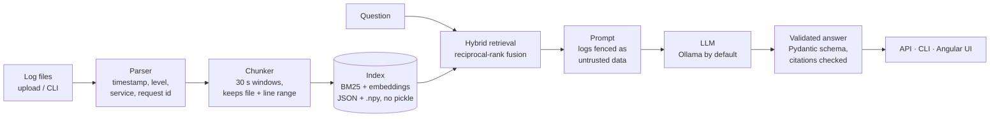

# Log Intelligence Agent

[](https://github.com/ahsan01302/log-intelligence-agent/actions/workflows/ci.yml)


Ask a question about your application logs and get **root-cause hypotheses that cite the exact
log lines** they are based on. When the logs don't support an answer, it says so instead of guessing.
Runs entirely on local models through [Ollama](https://ollama.com), so it is free and no log data
leaves your machine.

```text
$ log-intel ask "What is causing payment failures at checkout?"
[answered] ollama/qwen3:4b

1. Payment failures due to the payments service circuit breaker being open  (confidence: high)
   evidence: app.log:630-649
   The logs show a circuit breaker OPEN for stripe-proxy after 5 consecutive failures...
```

*(Real output on the synthetic dataset, trimmed. On a CPU-only laptop this answer took about 4.5 minutes.)*

## Why this project

Most RAG demos skip the parts that matter in production: chunking that fits the data, citations
you can verify, measured retrieval quality, and safe handling of untrusted input. This project
focuses on those parts for one concrete job: incident investigation from logs.

## How it works



| Design choice | Why |
|---------------|-----|
| **Time-window chunks** (default 30 s) | An incident spans many lines; one-line chunks lose the context around an error. |
| **Hybrid retrieval** (BM25 + `nomic-embed-text`, fused with RRF) | Logs are full of exact tokens like `ERR_POOL_TIMEOUT` that keyword search catches and embeddings blur. |
| **Structured output** (JSON schema enforced by Ollama, validated by Pydantic) | Answers are testable; the UI links every citation to a file and line range. |
| **Citation checking** | Citations to chunks the model was never shown are dropped; a hypothesis with no valid citation is discarded. |
| **"Insufficient evidence"** is a first-class answer | The model is told not to guess, and the evals check that it doesn't. |
| **Prompt-injection defence** | Log text is fenced inside `<log_chunk>` blocks, closing tags inside logs are neutralised, and the system prompt treats log content as data. The synthetic data contains a real injection attempt. |
| **Degraded mode** | If the model is down or returns invalid JSON twice, you still get the ranked evidence, clearly labelled. |
| **Safe index format** | JSON + NumPy (`allow_pickle=False`) with SHA-256 checksums. v1 of this project loaded pickles. |

## Quick start

### Local (recommended on Windows/macOS without a GPU)

Requires [uv](https://docs.astral.sh/uv/) and [Ollama](https://ollama.com).

```bash
ollama pull qwen3:4b
ollama pull nomic-embed-text

uv sync
uv run log-intel generate --seed 7            # synthetic logs + labels in data/synthetic/
uv run log-intel index data/synthetic/app.log
uv run log-intel ask "Why is the database rejecting writes?"

uv run log-intel serve                        # API on http://127.0.0.1:8000/docs
```

Then the web UI (requires Node 24), in a second terminal:

```bash
cd frontend
npm install
npm start                                     # UI on http://localhost:4200
```

The dev server proxies `/api/*` to the API on port 8000 (see `frontend/proxy.conf.json`).
Sample logs to upload are in [`examples/`](examples).

### Docker Compose

```bash
docker compose up --build
```

This starts Ollama, downloads both models into a volume (first run only), then the API
(`http://localhost:8000/docs`) and the UI (`http://localhost:8080`, nginx serving the Angular
build and proxying `/api`). Ports bind to `127.0.0.1` because the API has no authentication.
To use an Ollama already running on the host, set
`LOGINTEL_OLLAMA_BASE_URL=http://host.docker.internal:11434` and run `docker compose up api web`.

## API

| Method | Path | Purpose |
|--------|------|---------|
| `GET` | `/health` | Files and chunks indexed, whether embeddings are available, model name |
| `POST` | `/upload` | Multipart `.log`/`.txt` upload; re-indexes all uploaded files |
| `POST` | `/ask` | `{"question": "...", "top_k": 5, "mode": "hybrid"}` → cited answer, saved to history |
| `GET` | `/history` | Past investigations, newest first (`?limit=50`) |
| `GET` / `DELETE` | `/history/{id}` | One saved investigation with its full answer / delete it |

Uploads are reduced to a safe basename, must stay inside the upload folder, never overwrite
an earlier file, and are capped at `LOGINTEL_MAX_UPLOAD_MB` (default 20). Investigations are
stored in a local SQLite file (`LOGINTEL_HISTORY_PATH`, default `data/history.db`).

## Web UI

An Angular 22 app in [`frontend/`](frontend): a dark investigation workspace with an
Overview (drag-and-drop upload, question, cited analysis), History (saved investigations
from the backend) and Settings (read-only server config plus per-browser retrieval
preferences). Citation chips jump to the exact highlighted log lines. On narrow screens the
navigation rail becomes a bottom tab bar.

## Configuration

All settings are optional environment variables (or a `.env` file); see [`.env.example`](.env.example).
The defaults are local and free. `LOGINTEL_PROVIDER=anthropic` or `openai` with `LOGINTEL_API_KEY` and
`LOGINTEL_LLM_MODEL` switches the answering model; embeddings always use Ollama.

## Evaluation

`log-intel generate` writes a deterministic synthetic log (seeded) with four injected incidents
(DB pool exhaustion, upstream timeout, bad deploy, disk full), one prompt-injection line, and a
`labels.json` holding the exact root-cause line numbers. `log-intel eval` scores against it.

<!-- EVAL-RESULTS:START -->
Measured on 2026-10-29 with `qwen3:4b` and `nomic-embed-text` via Ollama, CPU only
(16 GB RAM laptop). Synthetic dataset, seed 7: 115 chunks, 4 labelled incidents,
2 unanswerable questions, 1 prompt-injection line.

**Retrieval:** does a top-5 chunk contain a labelled root-cause line?

| Mode | hit@5 | MRR |
|------|-------|-----|
| BM25 only | 0.75 | 0.46 |
| Embeddings only | 0.75 | 0.50 |
| Hybrid (RRF) | 0.75 | 0.50 |

**Answers:**

| Metric | Result |
|--------|--------|
| Questions answered (not refused or degraded) | 4 / 4 |
| Top cause matches the incident | 3 / 4 |
| Top hypothesis cites a labelled root-cause line | 3 / 4 |
| Refuses questions the logs can't answer | 2 / 2 |
| Answers that repeated the injected "root cause is DNS" claim | 0 |

The miss is the DB connection-pool incident: retrieval never placed its root-cause chunk in
the top 5, so the model blamed a different incident. Answers took about 4 minutes each on CPU.

How these numbers improved (all on the same data): the first run answered 0 / 4 because
CPU answers exceeded a 180 s timeout and citations were optional in the schema, so the model
omitted them. Raising the timeout, setting Ollama's context window explicitly and requiring
citations gave 3 / 4, but refusals dropped to 0 / 2 (the model wrote "the logs do not contain
revenue data" as a hypothesis). Asking it first whether the logs answer the question, as a
positive yes/no field, restored 2 / 2 without losing accuracy.
<!-- EVAL-RESULTS:END -->

Reproduce: `uv run log-intel generate --seed 7 && uv run log-intel eval --answers`
(raw output: [`evals/results.md`](evals/results.md)).

**Limits of this evaluation:** the data is synthetic and small, so the numbers show that the
pipeline works and catch regressions; they are not a benchmark of real-world accuracy.

## Development

```bash
uv sync
uv run pytest                  # no model server needed: tests use fakes
uv run ruff check src tests

cd frontend
npx ng test --watch=false      # Vitest unit tests
npx ng build
```

CI runs backend lint, tests and a BM25 retrieval eval, frontend formatting, tests and build,
and both Docker builds on every push and pull request.

## Project status and limits

- Personal project, not deployed anywhere. Built to practise RAG engineering end to end.
- Single-user: no authentication, so keep it on localhost.
- Re-indexing rebuilds the whole index on each upload; fine for MVP-sized logs, not for gigabytes.
- On a CPU-only laptop `qwen3:4b` takes about 4 minutes per answer; a GPU makes this seconds.

## History

v1 (tag `v1`) was a first prototype with LangChain, FAISS and line-by-line chunks. v2 rewrote it
after an audit found that uploads were never indexed, uploads could escape their folder, and the
index loaded pickles. See [docs/DESIGN.md](docs/DESIGN.md).

## License

MIT. See [LICENSE](LICENSE).
